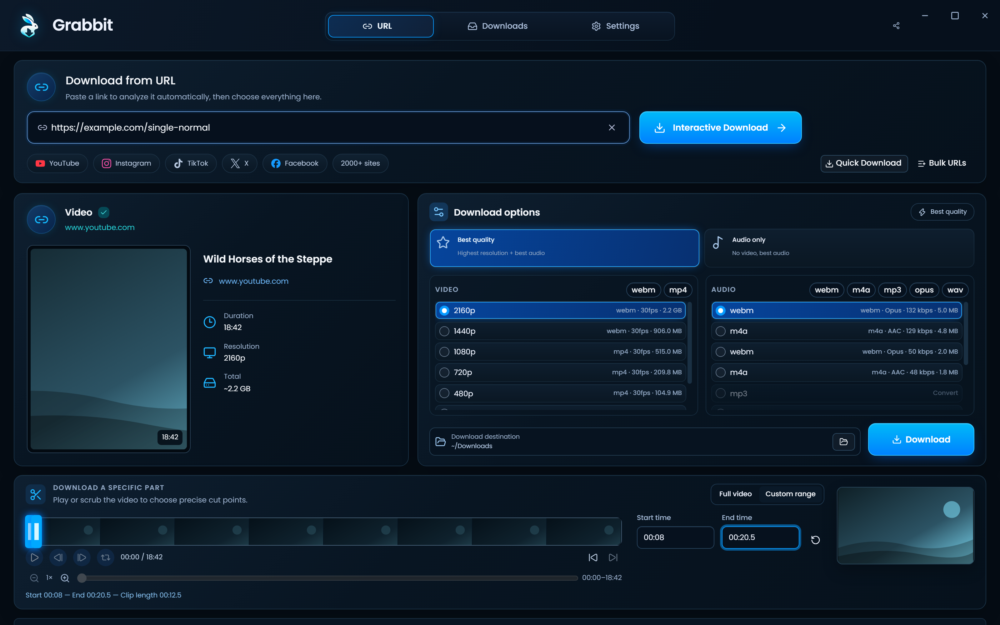

<div align="center">
  

# Grabbit

从 **YouTube 和 2000+ 个支持的网站**下载视频、Shorts、音乐、频道、播客或音轨 — 最高 4K HDR 60 fps，或导出为 MP3 / AAC / Opus。在 Windows、macOS 和 Linux 本地运行。**无广告、无冗余、无追加销售。**

</div>



## 功能特性

- **最佳画质 · 仅音频**
- **时间轴缩放 · 上一帧 · 下一帧 · 循环播放片段**
- **正在下载 → 正在合并 → 正在完成**
- 最高 **4K UHD（2160p）**、1440p、1080p、720p、480p、360p
- **音频** — 将仅音频导出为 MP3、M4A/AAC、Opus 或 WAV。在交互式下载中，可用时选择来源的原生环绕声/Dolby 音轨（AC-3、E-AC-3、5.1、DRC），或设置全局默认 **优先环绕声 / Dolby**
- **字幕**以 SRT、VTT 或 ASS 格式下载 — 手动或自动生成，支持任意可用语言
- **通过 yt-dlp 支持 2000+ 个其他网站** — Vimeo、Twitch、Twitter/X、TikTok、SoundCloud、Bandcamp、Bilibili、BBC iPlayer、archive.org 等众多网站

## 从源码构建

Node.js (`.node-version`) · Bun (`package.json`)

```bash
git clone https://github.com/tdnconcepts/Grabbit.git
cd Grabbit
bun run bootstrap
bun run doctor
bun run dev
```

```bash
bun run build
bun run dist
```

---

**阅读语言：** [Afaan Oromoo](README.om.md) · [Bahasa Indonesia](README.id.md) · [Deutsch](README.de.md) · [English](README.md) · [Español](README.es.md) · [Français](README.fr.md) · [Italiano](README.it.md) · [Kiswahili](README.sw.md) · [O'zbekcha](README.uz.md) · [Polski](README.pl.md) · [Português](README.pt.md) · [Tiếng Việt](README.vi.md) · [Türkçe](README.tr.md) · [አማርኛ](README.am.md) · [العربية](README.ar.md) · [اردو](README.ur.md) · [پښتو](README.ps.md) · [فارسی](README.fa.md) · [বাংলা](README.bn.md) · [हिन्दी](README.hi.md) · [ไทย](README.th.md) · [မြန်မာဘာသာ](README.my.md) · [Ελληνικά](README.el.md) · [Русский](README.ru.md) · [Српски](README.sr.md) · [Українська](README.uk.md) · **中文** · [日本語](README.ja.md) · [한국어](README.ko.md) · [繁體中文](README.zh-Hant.md)

MIT · [LICENSE](LICENSE) · [THIRD_PARTY_NOTICES.txt](THIRD_PARTY_NOTICES.txt)

_Last updated: 2026-10-21._
